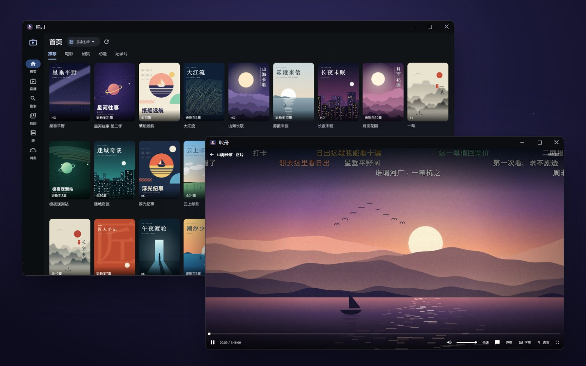
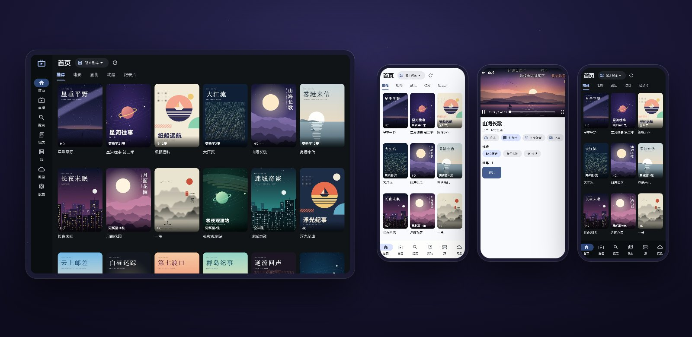
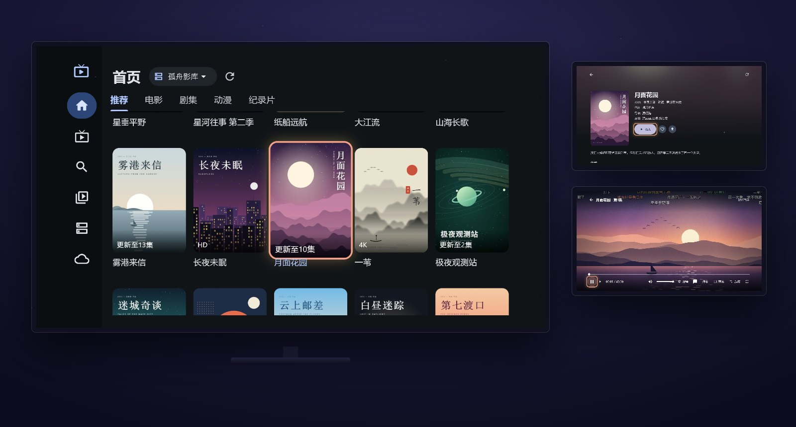
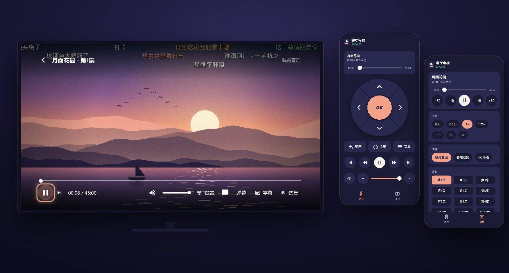
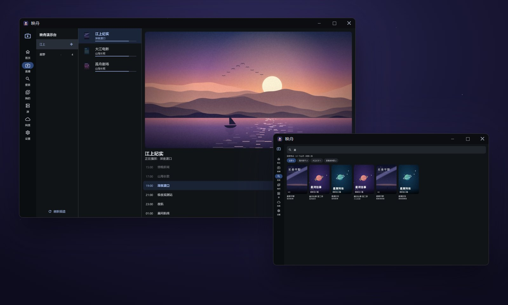
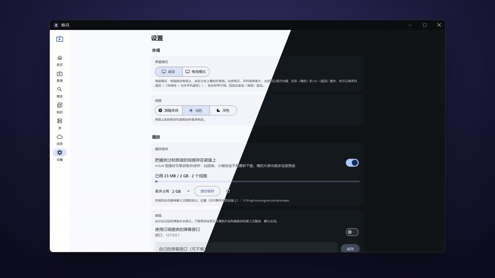
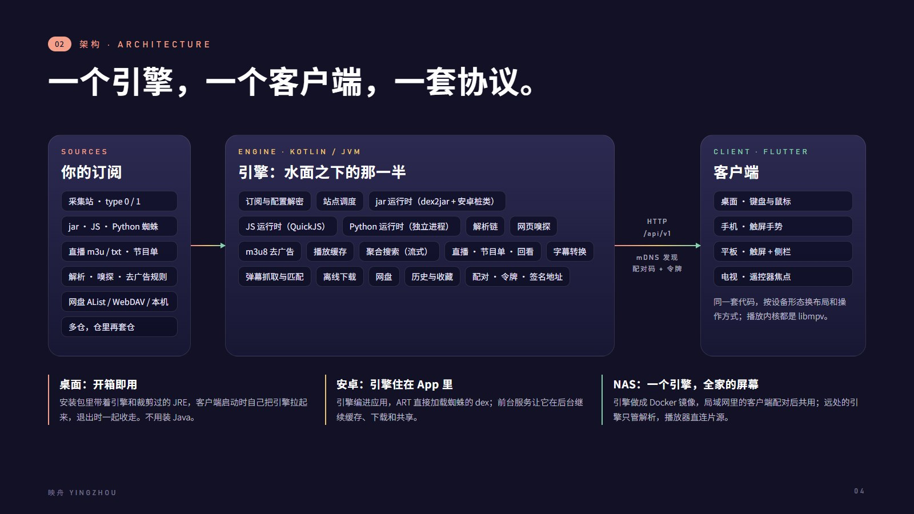
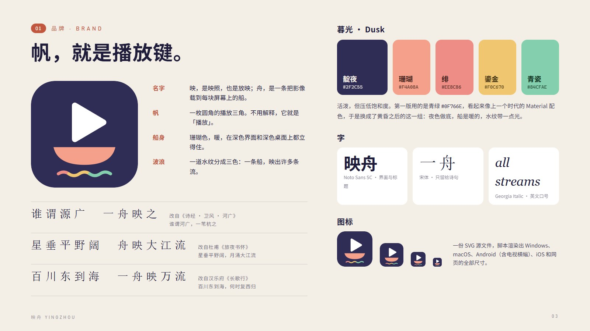

<p align="center"></p>

<p align="center">
  <b>兼容 TVBox 订阅与蜘蛛协议的全平台影视客户端</b><br>
  一个引擎 · 一个客户端 · 一套协议
</p>

<p align="center">
  <a href="https://github.com/Sa1koro/yingzhou/releases"></a>
  
  <a href="https://github.com/Sa1koro/yingzhou/pkgs/container/yingzhou-engine"></a>
  <a href="LICENSE"></a>
</p>

<p align="center">
  <a href="#下载">下载</a> · <a href="#界面">界面</a> · <a href="#特性">特性</a> · <a href="docs/user-guide.md">使用说明</a> · <a href="#品牌">品牌</a> · <a href="CHANGELOG.md">更新记录</a>
</p>

> 谁谓源广？一舟映之。

TVBox 的订阅生态很大，能好好用它的地方却几乎只有安卓。映舟把它带到 Windows、macOS、手机、平板和电视上，而且在每一种设备上都按那种设备的习惯来操作：桌面用键鼠，手机用手势，电视用遥控器。

映舟只是一条船：**不内置、不提供任何影视内容或订阅源**，看什么由你的订阅决定。

## 界面



**桌面**（Windows · macOS）：海报墙随窗口宽度排列，站点下拉即切；播放器是 libmpv，弹幕、字幕、音轨、倍速都在底栏。空格、F、方向键、鼠标侧键，桌面上该有的都有。



**手机与平板**：双击快进，上下滑调亮度和音量，长按两倍速，上滑回桌面变小窗；深浅色跟随系统。



**电视与盒子**：方向键走焦点，OK 即播，菜单键调出倍速、线路、字幕和选集；要打字时，用手机扫电视上的二维码。



**用手机遥控**：电视或电脑上打开「允许手机遥控」，手机相机扫一下就是遥控器，不用装应用，iPhone 也行。方向键到了大屏上就是遥控器按键；进度、倍速、线路、选集、字幕、直播换台和打字，都能在手机上做。电脑接在电视上时，切到「电视模式」就是同样的十英尺界面。



**直播与搜索**：分组、节目单、回看，线路打不开自动换下一条；所有站点同时搜，结果边搜边出。



**设置与明暗**：「源」只管内容从哪里来，映舟和引擎怎么工作都在「设置」里；浅色、深色跟随系统或手动选。检查更新、GitHub 加速测速、崩溃记录与问题反馈也在这里，默认都不会自己联网。

<sub>截图来自真实应用。片名、海报和弹幕是为演示制作的虚构内容（见 <a href="tools/promo">tools/promo</a>）。</sub>

## 特性

**源**
- 兼容 TVBox 配置：采集站（type 0 / 1）、jar / JS / Python 蜘蛛、解析与网页嗅探、去广告规则，以及配置里的 `hosts` / `headers` / `doh`
- 多仓订阅，仓里再套仓；保存多条订阅，一键切换
- 直播：TXT / M3U / JSON 列表、节目单（DIYP / XMLTV）、回看、蜘蛛提供的直播
- 网盘：AList、WebDAV、本机文件夹
- 豆瓣推荐之类只有片名的站点：点海报自动到别的站点找能播的；线路全坏时自动换站接着播，也可以「换一个」
- 首页顶上直接切换订阅、仓库和站点

**播放**
- libmpv 内核，硬件解码；播放缓存让 m3u8 拖动进度条不再卡半天
- 线路失效自动换线，带着进度接着播；手动选的线路不会被换走
- 弹幕、外挂字幕与音轨（ASS 由 libass 渲染）
- 离线下载、历史、收藏、续播

**引擎**
- 一个引擎服务全家的屏幕：局域网配对（配对码 + 令牌，mDNS 发现），也可以住进 NAS（Docker）
- 手机当遥控器：扫码即用的网页遥控器（iPhone 也行），按键、播放、选集、字幕、直播换台、打字，引擎做中转
- 连着远处的引擎时，引擎只负责解析和去广告，播放器直连片源
- 会把数据交给第三方的功能（GitHub 加速、DoH、订阅自带的弹幕接口、自动检查更新）都是开关，默认关闭

**应用**
- 浅色 / 深色可选；「设置」和「源」分开
- 检查更新，可走 GitHub 加速代理或自己的 HTTP 代理
- 崩溃记录留在本机，一键复制诊断信息、打开预填好的问题反馈，不自动上传任何东西

## 下载

在 [Releases](https://github.com/Sa1koro/yingzhou/releases) 下载，由 GitHub Actions 自动构建（目前都是预发布版）。

| 平台 | 安装包 | 状态 |
|---|---|---|
| Windows 10 / 11 | `yingzhou-windows-x64-setup.exe`（安装程序）或 `yingzhou-windows-x64.zip`（绿色包） | ✅ 可用 |
| macOS（Apple Silicon） | `yingzhou-macos-arm64.dmg` | ✅ 真机验证 |
| Linux（x64，Ubuntu 24.04 / Debian 13 起） | `yingzhou-linux-x64.deb` 或 `yingzhou-linux-x64.tar.gz` | 🧪 只在 CI 的虚拟屏幕上验证过 |
| Android TV · 电视盒子 | `yingzhou-android-arm64-v8a.apk`；32 位的老盒子用 `armeabi-v7a` | ✅ 真机验证 |
| Android 手机 · 平板（7.0 起） | 同上，一个安装包 | 🧪 只在模拟器上验证过 |
| 引擎（NAS 等） | Docker 镜像 `ghcr.io/sa1koro/yingzhou-engine` | 🧪 CI 自检通过，未在 NAS 上验证 |
| iOS | — | 计划中：纯客户端，连局域网或 NAS 上的引擎 |

- Windows、macOS、Linux 的包里带着引擎和精简过的 Java 运行时，不用另装 Java（Linux 的播放器 libmpv 用系统的，装 deb 时 apt 会带上）。
- Windows 版没有数字签名，第一次运行时 SmartScreen 可能拦一下，点「更多信息 → 仍要运行」。macOS 版是临时签名，第一次需右键 → 打开。
- 安卓 APK 用正式密钥签名，可以覆盖升级。

## 快速开始

1. 安装并打开映舟。
2. 在「源」页填入订阅地址并导入。电视上可以点「手机输入」，用手机扫码把地址发过去。外观、网络、局域网共享、检查更新等在「设置」里。
3. 在首页浏览，或者用「搜索」（桌面上按 Ctrl+F）。

快捷键、手势、遥控器操作和常见问题见 [使用说明](docs/user-guide.md)；在 NAS 上跑引擎见使用说明第 8 节。

## 架构



引擎和客户端之间只有 HTTP，所以引擎可以装在不同的地方：桌面安装包里带着它，客户端启动时把它拉起来；安卓 App 把它编进应用，ART 直接加载蜘蛛；也可以用 Docker 放进 NAS，让局域网里的设备配对后共用。客户端是一套 Flutter 代码，按设备形态换布局和操作方式。详见 [架构文档](docs/architecture.md)。

`lab/engine-go` 分支用于试验轻量化引擎。Go 可直接读取肥猫原始订阅，实验版桌面引擎可将这个地址交给本机 Go 服务。本期单独运行 Go 导出 13/40 个入口，配上匹配的 Windows x64 原生蜘蛛宿主后导出 32/40 个。[导入方式与逐站实测](lab/engine-go/README.md)

## 品牌



名字取「一条船把影像载到每块屏幕上」；logo 的帆就是播放键，船身是珊瑚色，船下一道水纹分成三色：一条船，映出许多条流。配色叫「暮光」，夜色做底。标志、色板、字体和口号见 [docs/brand](docs/brand/README.md)。

## 文档

| 文档 | 内容 |
|---|---|
| [使用说明](docs/user-guide.md) | 各页面怎么用、快捷键、手势、遥控器、常见问题 |
| [兼容性](docs/compatibility.md) | TVBox 配置逐字段的支持情况 |
| [路线图](docs/roadmap.md) | 接下来做什么、先后顺序、想法池 |
| [进度](docs/status.md) | 里程碑、已验证 / 未验证、已知缺口 |
| [需求](docs/requirements.md) | 目标、平台优先级、功能清单 |
| [架构](docs/architecture.md) | 引擎 / 客户端 / 协议的分工，各子系统的实现 |
| [引擎协议](docs/protocol.md) | 客户端与引擎之间的 HTTP 接口 |
| [技术选型](docs/tech-choices.md) | 与 MisaTV 等方案的对比、内存实测 |
| [开发指南](docs/development.md) | 环境、命令、演示引擎、集成测试、打包、排错 |
| [设计工作流](docs/design-lab.md) | 设计台（四种设备并排、热重载）、流程分镜（步数与等待）、审阅清单 |
| [品牌](docs/brand/README.md) | 标志、色板、字体、口号 |
| [更新记录](CHANGELOG.md) | 每个版本和每次迭代改了什么 |

## 开发

需要 JDK 21、Flutter 3.50+；安卓需要 Android SDK；Windows 桌面需要 Visual Studio 的"使用 C++ 的桌面开发"工作负载。仓库目录里的工程仍叫 `tvbox-next`。

```bash
# 引擎：测试、运行（默认只监听 127.0.0.1:9978）
cd engine
./gradlew test
./gradlew :server:run --args="--port 9978 --subscribe <订阅地址>"

# 客户端：桌面版启动时若 9978 上没有引擎，会自己在后台拉起内置引擎
cd client
flutter test
flutter run -d windows

# 打包：Windows 出安装程序和绿色包，Mac 上出 DMG，Linux 上出 deb 和 tar.gz
tools/package-desktop.sh
```

打一个 `v*` 标签就会触发 `.github/workflows/desktop.yml`，出 Windows、macOS、Linux、安卓的包并发布 Release，并更新检查更新用的 `latest.json`；推送到 main 会构建引擎的 Docker 镜像。演示引擎、集成测试和排错见 [开发指南](docs/development.md)；宣传片和作品集的源文件在 [tools/promo](tools/promo/README.md)。

| 目录 | 内容 |
|---|---|
| `engine/` | Kotlin/JVM 引擎（Gradle）：`core` 协议逻辑、`api` HTTP 路由、`server` 独立进程入口、`runtime-js` / `runtime-jar` / `runtime-py` 蜘蛛运行时 |
| `client/` | Flutter 客户端（Windows / macOS / Linux / Android / iOS） |
| `tools/` | 打包、安装程序、订阅体检、品牌图标、宣传物料 |
| `docs/` | 文档、品牌、截图 |

## 许可

AGPL-3.0，见 [LICENSE](LICENSE)。

- 部分实现移植自 [TVBoxOS](https://github.com/q215613905/TVBoxOS) 与 [takagen99/Box](https://github.com/takagen99/Box)（AGPL-3.0）。
- `engine/core/.../util/UriUtil.kt` 移植自 ExoPlayer（Apache-2.0），保留原版权声明。
- 桌面 jar 运行时的安卓桩类与 dex2jar 修复源自 [Win-box](https://github.com/yagami-hue/Win-box)（MIT）。
- 完整的来源与许可证声明见 [THIRD-PARTY-NOTICES.md](THIRD-PARTY-NOTICES.md)。

本项目只是播放器外壳，不内置、不提供任何影视内容或订阅源。
