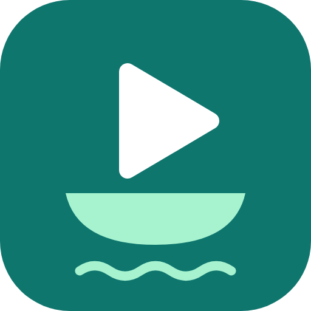

<p align="center"></p>

# 映舟 Yingzhou

> 一个兼容 TVBox 配置与蜘蛛协议的全平台影视客户端：一个 Kotlin 引擎 + 一个 Flutter 客户端 + 一套 HTTP 协议。名字取"一条船把影像载到每块屏幕上"，对应一个引擎服务多台设备；logo 的帆就是播放键（见 [docs/brand](docs/brand)）。仓库目录仍叫 `tvbox-next`。

**现状**：Windows 桌面版可用（点播、搜索、jar / js 蜘蛛、解析、嗅探、去广告、直播 + 节目单），macOS 的工程与打包已就绪但未在真机验证。Android 手机、平板和电视盒子的界面（触屏手势、遥控器焦点）以及内置引擎的缓存、下载、局域网共享已经做了，只在模拟器上验证过。详见 [docs/status.md](docs/status.md)。

## 文档

| 文档 | 内容 |
|---|---|
| [docs/requirements.md](docs/requirements.md) | 需求：目标、平台优先级、功能清单与状态 |
| [docs/status.md](docs/status.md) | 进度：里程碑、已验证 / 未验证、已知缺口、下一步 |
| [docs/user-guide.md](docs/user-guide.md) | 使用说明：各页面怎么用、快捷键、常见问题 |
| [docs/compatibility.md](docs/compatibility.md) | 兼容性：TVBox 配置逐字段的支持情况 |
| [docs/architecture.md](docs/architecture.md) | 架构：引擎 / 客户端 / 协议的分工，各子系统的实现 |
| [docs/tech-choices.md](docs/tech-choices.md) | 技术选型对比：MisaTV 的实际实现、Compose 等方案、内存实测 |
| [docs/protocol.md](docs/protocol.md) | 引擎协议：客户端与引擎之间的 HTTP 接口 |
| [docs/development.md](docs/development.md) | 开发指南：环境、命令、演示引擎、集成测试、打包、排错 |
| [CHANGELOG.md](CHANGELOG.md) | 更新记录 |

## 下载

在 [Releases](https://github.com/Sa1koro/yingzhou/releases) 下载，由 GitHub Actions 自动构建（目前都是预发布版）：

- Windows：`yingzhou-windows-x64-setup.exe`（安装程序）或 `yingzhou-windows-x64.zip`（绿色包）。没有数字签名，第一次运行时 SmartScreen 可能拦一下，点「更多信息 → 仍要运行」。
- macOS（Apple Silicon）：`yingzhou-macos-arm64.dmg`，临时签名，第一次需右键 → 打开。还没有在真机上运行过。
- Android（手机、平板、电视盒子，Android 7.0 起）：`yingzhou-android-arm64-v8a.apk` 适合绝大多数手机和较新的盒子，`armeabi-v7a` 给 32 位的老电视盒子。从 v0.3.0 起提供，用正式密钥签名，可以覆盖升级。
- 引擎的 Docker 镜像：`ghcr.io/sa1koro/yingzhou-engine`，见 [docs/user-guide.md](docs/user-guide.md)。

打一个 `v*` 标签就会触发 `.github/workflows/desktop.yml` 出包并发布 Release。

## 使用（Windows）

1. 从 Releases 下载，或运行 `tools/package-desktop.sh` 得到安装程序 `dist/yingzhou-windows-x64-setup.exe`（需要 Inno Setup）和绿色包 `dist/yingzhou-windows-x64.zip`。
2. 运行安装程序，或解压绿色包后运行 `yingzhou.exe`。不需要安装 Java，引擎和运行时都在包里。
3. 在左侧「源」页填入订阅地址。订阅、历史、收藏保存在 `~/.tvbox-next/engine`。

网页嗅探用系统里的 Edge 或 Chrome（Windows 10/11 自带 Edge）。各页面的用法和常见问题见 [docs/user-guide.md](docs/user-guide.md)。

## 目录

| 目录 | 内容 |
|---|---|
| `engine/` | Kotlin/JVM 引擎（Gradle）：`core` 协议逻辑、`api` HTTP 路由、`server` 独立进程入口、`runtime-js` / `runtime-jar` 蜘蛛运行时 |
| `client/` | Flutter 客户端（Windows / macOS / Linux / Android / iOS） |
| `tools/` | 打包脚本 |
| `docs/` | 文档 |

## 开发

完整说明见 [docs/development.md](docs/development.md)。

需要 JDK 21、Flutter 3.50+；Android 需要 Android SDK；Windows 桌面需要 Visual Studio 的"使用 C++ 的桌面开发"工作负载。

```bash
# 引擎：测试、运行（默认只监听 127.0.0.1:9978）
cd engine
./gradlew test
./gradlew :server:run --args="--port 9978 --subscribe <订阅地址>"

# 客户端
cd client
flutter test
flutter run -d windows
```

桌面客户端启动时，如果 127.0.0.1:9978 上没有引擎，会自动在后台启动内置引擎（开发时用 `engine/server/build/install/tvbox-engine`，打包后用 `engine/` 目录和自带的精简 JRE），客户端退出时引擎随之退出。

打包桌面版（客户端 + 引擎 + jlink 精简 JRE）：Windows 上输出 `dist/yingzhou-windows-x64.zip` 和安装程序 `dist/yingzhou-windows-x64-setup.exe`（装了 Inno Setup 时），Mac 上输出 `dist/yingzhou-macos-<arm64|x86_64>.dmg`（JRE 跟构建机的 CPU 走；默认临时签名，设 `SIGN_IDENTITY` 用开发者证书签名）。没有 Mac 时，把仓库推到 GitHub 后用 `.github/workflows/desktop.yml` 一次出三个包。

```bash
tools/package-desktop.sh
```

桌面端操作：

| 按键 / 鼠标 | 作用 |
|---|---|
| 单击画面 / 空格 | 播放、暂停 |
| 双击画面 / F | 全屏，Esc 退出全屏 |
| ← / →（按住 Shift） | 后退 / 快进 10 秒（60 秒） |
| ↑ / ↓、滚轮 | 音量，M 静音（音量会记住） |
| [ / ] | 减速 / 加速 |
| N / P（PageDown / PageUp） | 下一集 / 上一集 |
| 鼠标侧键后退、Alt+←（播放页里也可按 Esc） | 返回上一页 |
| Ctrl+F（Mac 上 ⌘F） | 搜索 |

点播的线路放不了时会自动换到下一条，从原来的进度接着播；手动选的线路不会被换走（[使用说明](docs/user-guide.md)第 4 节）。

直播页：↑ / ↓ 换台，← / → 换线路，PageUp / PageDown 换分组，F 或双击全屏（Esc 退出），M 静音，滚轮调音量。线路打不开会自动换下一条。

窗口大小、位置和是否最大化会在下次启动时恢复。

## 许可

AGPL-3.0，见 [LICENSE](LICENSE)。

- 部分实现移植自 [TVBoxOS](https://github.com/q215613905/TVBoxOS) 与 [takagen99/Box](https://github.com/takagen99/Box)（AGPL-3.0）。
- `engine/core/.../util/UriUtil.kt` 移植自 ExoPlayer（Apache-2.0），保留原版权声明。
- 桌面 jar 运行时的安卓桩类与 dex2jar 修复源自 [Win-box](https://github.com/yagami-hue/Win-box)（MIT）。
- 完整的来源与许可证声明见 [THIRD-PARTY-NOTICES.md](THIRD-PARTY-NOTICES.md)。

本项目只是播放器外壳，不内置、不提供任何影视内容或订阅源。
