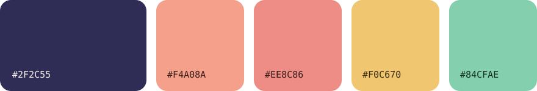
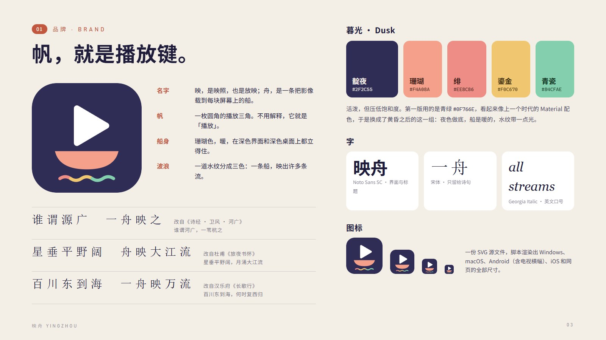

# 品牌


## 名字

**映舟 · Yingzhou**。映，是映照，也是放映；舟，是一条把影像载到每块屏幕上的船。一个引擎载着订阅里的千源万流，渡到桌面、手机、平板和电视上，所以英文口号是：

> **One boat, all streams.**

## 标志

<p>
  
  &nbsp;&nbsp;
  
</p>

| 部分 | 含义 |
|---|---|
| 帆 | 一枚圆角的播放三角。不用解释，它就是「播放」 |
| 船身 | 珊瑚色，暖，在深色界面和深色桌面上都立得住 |
| 波浪 | 一道水纹分成三色：一条船，映出许多条流 |
| 底 | 靛夜色的圆角方块，各平台的图标都用它 |

- `yingzhou-logo.svg` 是母版，48 px 以上都用它。
- `yingzhou-logo-small.svg` 给 16–32 px（任务栏、标签页）：去掉波浪，帆和船身放大，小了也认得出。
- `yingzhou-banner.svg` 是 Android TV 桌面的横幅（320 × 180）。
- 帆永远是白色，船身永远是珊瑚色，三色水纹的顺序不变（绯、鎏金、青瓷，从左到右）。
- `logo-candidates.svg` 是定稿前的候选，留作记录。

各平台的图标（Windows .ico、macOS AppIcon、安卓启动图标与电视横幅、iOS、网页、安装程序的向导图）都由脚本从 SVG 母版画出，不手改位图：

```bash
node tools/brand/render-icons.mjs
node tools/brand/render-banner.mjs
```

## 色板：暮光



| 名字 | 色值 | 用在 |
|---|---|---|
| 靛夜 | `#2F2C55` | 图标底色、深色背景 |
| 珊瑚 | `#F4A08A` | 船身、强调、焦点框、标签 |
| 绯 | `#EE8C86` | 水纹第一段 |
| 鎏金 | `#F0C670` | 水纹第二段、数字与高亮 |
| 青瓷 | `#84CFAE` | 水纹第三段、「可用」一类的状态 |

活泼，但压低饱和度。第一版用的是青绿 `#0F766E`，看起来像上一个时代的 Material 配色，于是换成了黄昏之后的这一组：夜色做底，船是暖的，水纹带一点光。

## 字

| 用途 | 字体 |
|---|---|
| 界面与标题 | Noto Sans SC / 微软雅黑 / 苹方（客户端按这个顺序回退） |
| 诗句 | 宋体，只留给诗句，不用在界面里 |
| 英文口号 | Georgia Italic |
| 字母标（YINGZHOU）与小标签 | Bahnschrift / Segoe UI，字距拉开 |

## 口号与诗句

| 句子 | 出处 |
|---|---|
| 谁谓源广？一舟映之。 | 改自《诗经 · 卫风 · 河广》：谁谓河广，一苇杭之 |
| 星垂平野阔，舟映大江流。 | 改自杜甫《旅夜书怀》：星垂平野阔，月涌大江流 |
| 百川东到海，一舟映万流。 | 改自汉乐府《长歌行》：百川东到海，何时复西归 |

三句诗在宣传片里依次分出三幕：源、屏、核。

## 宣传物料

- `yingzhou-hero.jpg`：README 顶部的横幅。
- `social-preview.png`（1280 × 640）：GitHub 仓库的社交预览图，要在仓库的 Settings → General → Social preview 里手动上传。
- `brand-board.jpg`：品牌页，取自作品集。
- 宣传片《一舟映之》和作品集 PDF 由 [tools/promo](../../tools/promo/README.md) 生成：画面逐帧渲染，界面是真实应用的截图，配乐由代码合成。README 里的截图也由那里的 `make-readme-images.mjs` 生成。


