# 原型：三种用法、电视播放页的拨盘、网页控制台

映舟的界面原型，用「夜航」设计系统画成：三种用法（简单、标准、开发者）、电视播放页的拨盘、配对后在浏览器里用的网页控制台。原型定的是**要做什么、各放在哪、先看到什么**；应用里的实际样子以代码为准，两者对应关系见每张图下面。五节的界面都已经在应用里（拨盘和控制台还没有发布），和原型不一样的地方在每张图下面写着。

- 图片可以直接看；`*.html` 用浏览器打开就是同一块画板，板与板之间的链接能点（比如「继续播放」进播放页）。
- `canvas/` 是这些画板的源文件，给 Claude 的 Design 画布用（`canvas.json` 记着每块画板的位置和标题）。改原型改这里，然后运行 `node tools/design/export-prototypes.mjs` 重新生成旁边的 `*.html` 和图片。
- 图里的片名、频道、站点名、海报都是虚构的演示内容。

## 第一次打开：选一种用法

| 电视 | 手机（浅色） |
|---|---|
|  | 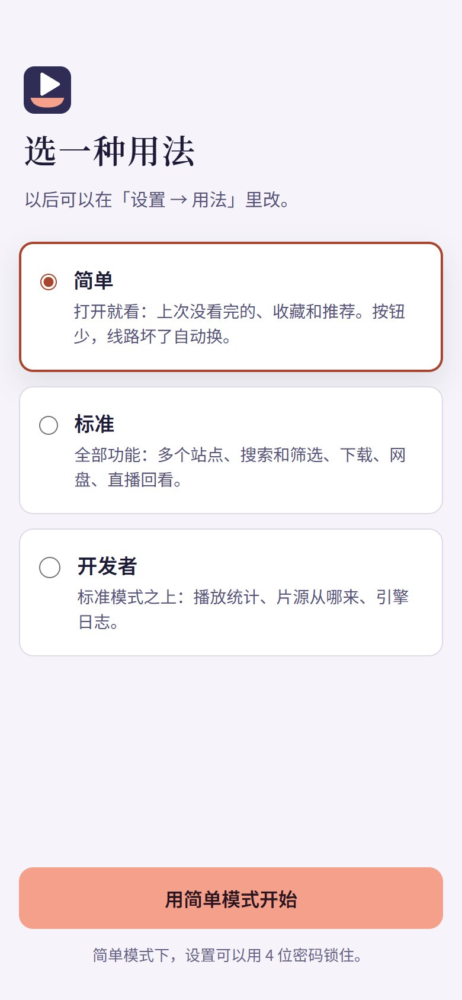 |

三张卡片，每张写清楚这种用法做什么、给谁用。电视上焦点落在「简单」，按 OK 就用它开始；手机上先选再点下面的按钮。以后在「设置 → 外观 → 用法」里换。

应用里：`client/lib/pages/mode_chooser.dart`。只在全新安装第一次打开时出现。

## 简单模式：打开就看

- 首页最先看到的是上次没看完的那部片，焦点直接在「继续播放」上，按一下就从停下的地方接着放。
- 顶上的站点按钮打开右边的弹出栏换站点（和订阅、多仓里的仓库），不用进设置。
- 下面是最近看过和收藏；站点的推荐和分类在后面的标签里。

应用里：首页第一个标签「继续看」（`simple_home.dart`），站点按钮和弹出栏在 `home_switcher.dart`。原型里「常看的频道」一行，应用里是「最近看过」和「收藏」两行海报。

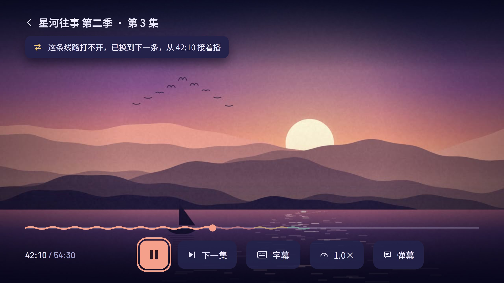

- 线路坏了自动换，只说一句人话："这条线路打不开，已换到下一条，从 42:10 接着播"，不出现错误码和网址。
- 控制条：暂停 / 继续、下一集、字幕、倍速、弹幕。不列线路；只有所有线路都试过还不行时，才让人自己挑。
- 进度条是三色水纹：珊瑚色是看过的，后面淡色的是已经缓冲的。

| 手机首页（浅色） | 设置上锁（浅色） |
|---|---|
|  | 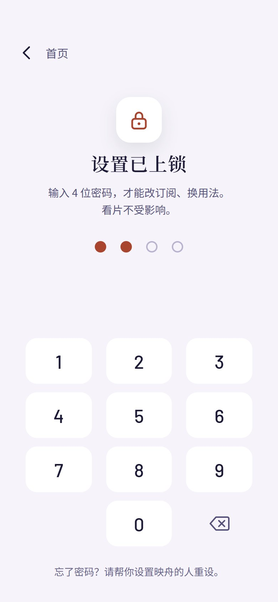 |

- 手机上同样是一张「继续看」的大卡片，一个占满宽度的「继续播放」，站点按钮在标题旁边。
- 设置可以用 4 位密码锁住：防的是误改订阅和用法，看片、直播、搜索都不受影响。电视上可以直接按遥控器的数字键。

应用里：`ui/pin_pad.dart`。忘记密码的办法见使用说明。

## 开发者模式：看清每一步

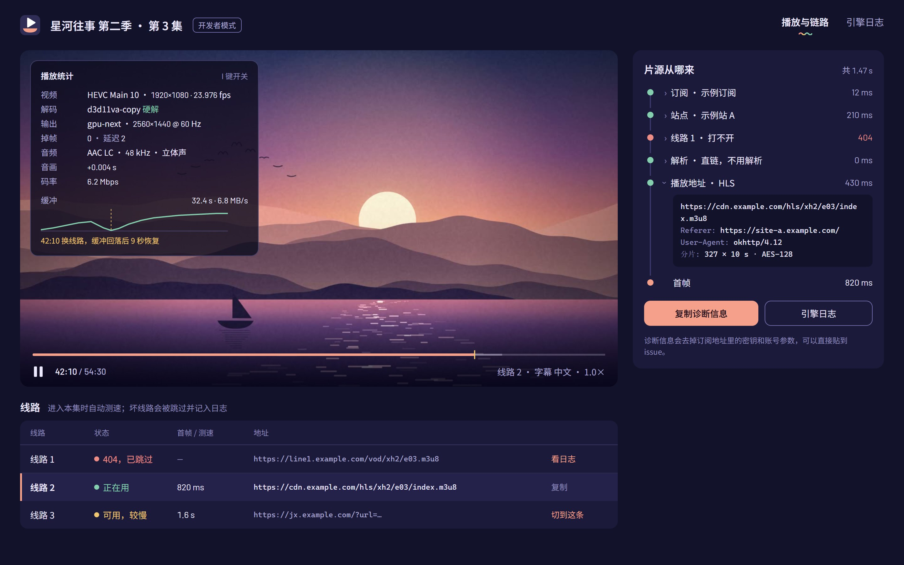

- 画面左上角的播放统计（按 I 开关）：编码、分辨率、帧率、硬解还是软解、输出、掉帧、音频、音画同步、码率、缓冲和网速，数字来自 libmpv。
- 右边「片源从哪来」：订阅 → 站点 → 线路（被跳过的线路和原因也列着）→ 解析 → 播放地址和请求头 → 首帧，每一步多少毫秒。「复制诊断信息」会先去掉订阅地址和密钥。
- 下面是线路对比：哪条打不开、哪条正在用、哪条慢。

应用里：`pages/player_dev.dart`。播放统计和链路面板已有；线路对比表还没有做，线路的情况在链路面板和日志里。

- 每一步的记录，最新的在上面；按级别筛选、搜索；选中一条在右边看它的地址、回应和请求头，可以「复制为 curl」。

应用里：`diagnostics/dev_log_page.dart`，记的是这台设备上客户端看到的每一步（连接引擎、加载订阅、解析、出画面、线路失败、换线路、换站点）。引擎自己的日志接口和「复制为 curl」还没有做。

## 电视播放页：拨盘

按键怎么分见 [../ux-review.md](../ux-review.md) 的 2.2，规则见[设计系统的「交互」](../system/README.md)。电视上的控制栏不再放按钮，只显示信息；所有操作从拨盘走。

- **信息条**：按 OK 暂停（或者按任意键）时出现，上面没有能聚焦的东西。左上是片名、线路、清晰度；右上是现在几点、还剩多久、大约几点看完；下面是进度。
- 没有屏显时 ← → 调进度、OK 暂停、↑ ↓ 叫出拨盘；返回要连按两次才退出播放。
- 最下面一行按键提示只在头几次出现。

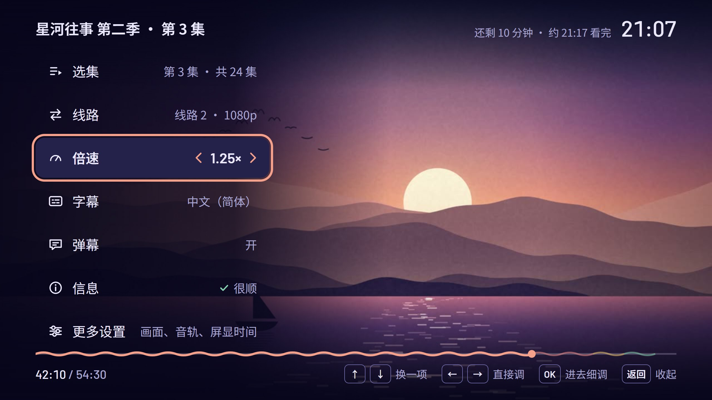

- **拨盘**：↑ 或 ↓ 叫出，停在上次用的那一项。七项，每项右边就是现在的值，一眼看完：选集、线路、倍速、字幕、弹幕、信息、更多设置。
- ↑ ↓ 换一项；**← → 直接调**（倍速逐档、弹幕开关、字幕轮换、上一集下一集、换线路）；OK 进去细调；返回收起。
- 原来控制栏上的弹幕开关、弹幕、统计、链路四个按钮，收进「弹幕」和「信息」两项。画面比例、音轨、屏显时间在「更多设置」里；没有菜单键的遥控器从这里进设置，长按 OK 也行。

| 拨盘 → 线路 | 拨盘 → 播放信息 |
|---|---|
| 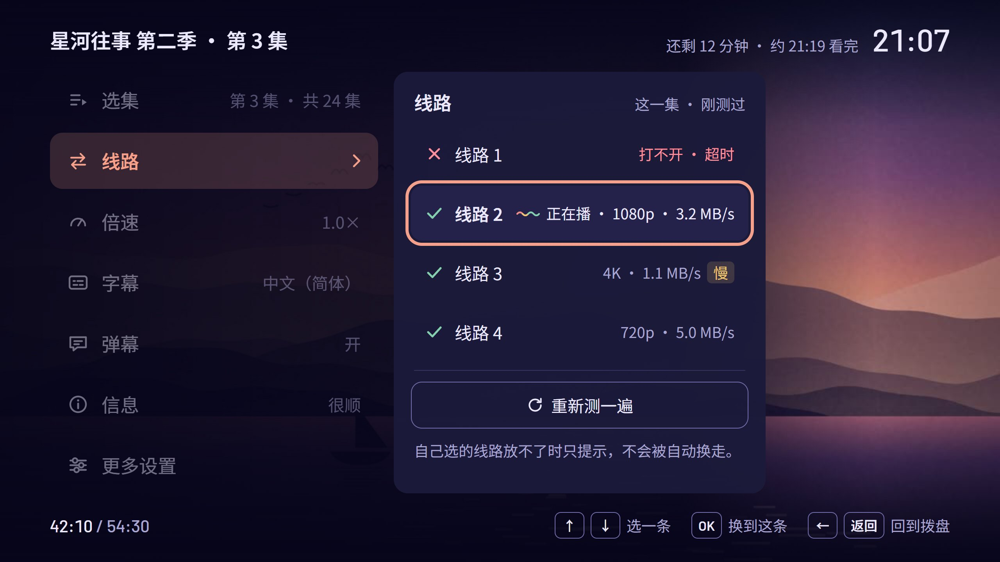 | 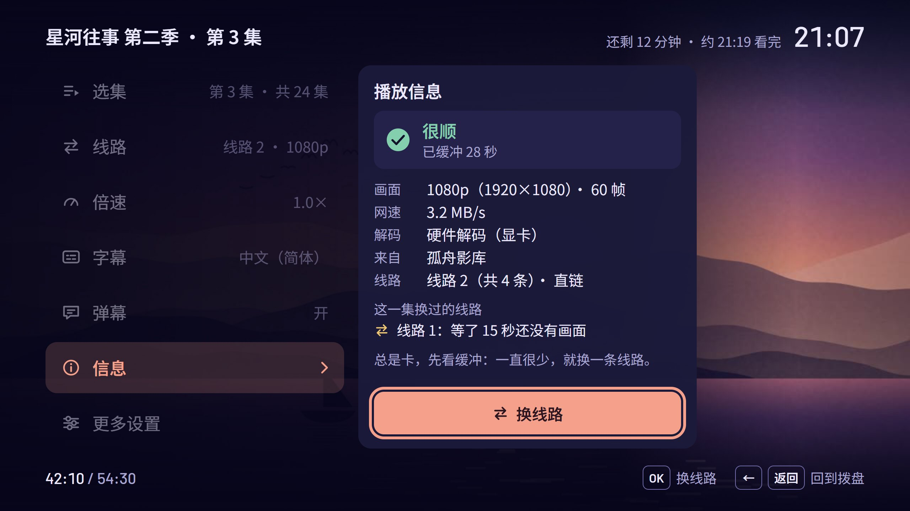 |

- 面板紧挨着拨盘向右展开，眼睛不用横穿屏幕；拨盘上进来的那一项保持选中，其余变暗。在面板里按 ← 或返回回到拨盘。
- **线路**：每条线路后面是体检结果（能不能播、清晰度、网速、慢不慢），焦点在正在播的那条上。简单模式叫「线路 1、线路 2」，其他用法用站点起的名字。
- **播放信息**：一句判断（很顺 / 够用 / 快见底了 / 正在缓冲）、画面、网速、解码、来自哪、这一集换过哪些线路，下面直接能「换线路」。

应用里：`pages/player_tv.dart`、`pages/player_dial.dart`，四块画板都做了；按键提示一直显示（原型说只在头几次出现，还没做）。

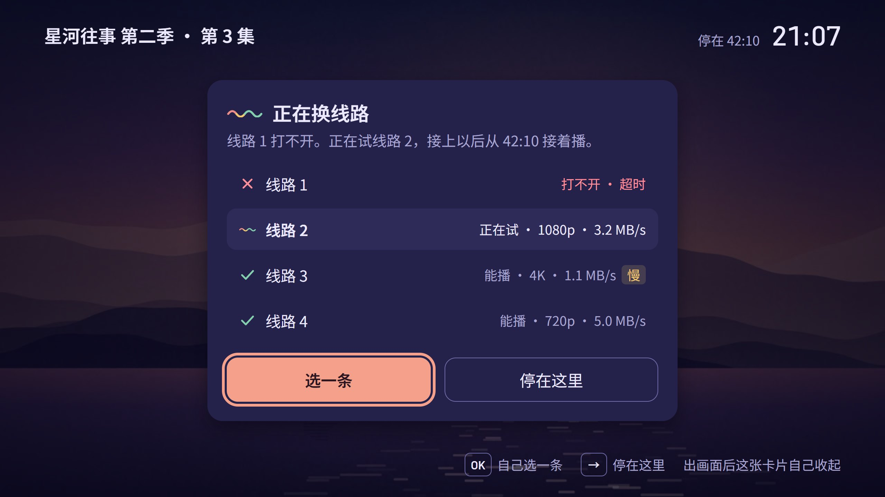

- **正在换线路**：一条线路打不开要换的时候，画面中间不再是一个转圈，而是这张卡片：每条线路的状态，正在试的那条有水纹；焦点在「选一条」上，随时可以自己挑，或者「停在这里」。出画面后自己收起。

应用里：`pages/player_switching.dart`，电脑、手机上也有同样的卡片。线路体检见 [../line-probe.md](../line-probe.md)。

## 网页控制台

配对之后，手机和电脑的浏览器里除了遥控器，还能做电视上不方便做的事。设计说明见 [../web-console.md](../web-console.md)。应用里：引擎的 `/remote/`，七块画板都做了；只有深色，收藏只显示片名（网页的安全策略不让加载别的网站的海报）。

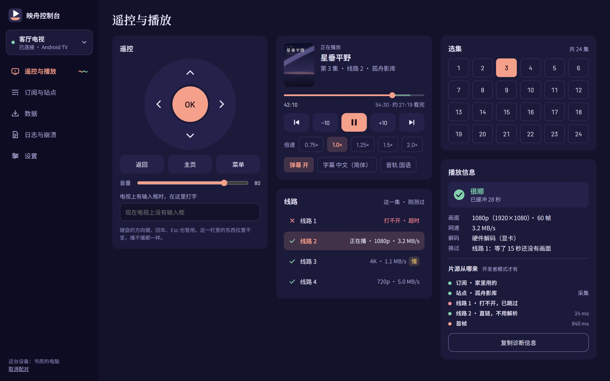

- 电脑浏览器是左侧导航加宽屏布局。第一页把遥控器和「正在播放」放在一起：左边的遥控器位置永远不变（播不播都一样，输入框也一直在，电视上没有输入框时是灰的）；中间是进度、倍速、弹幕字幕和带体检结果的线路；右边是选集、播放信息，开发者模式多一段「片源从哪来」。

| 订阅与站点 | 数据 |
|---|---|
| 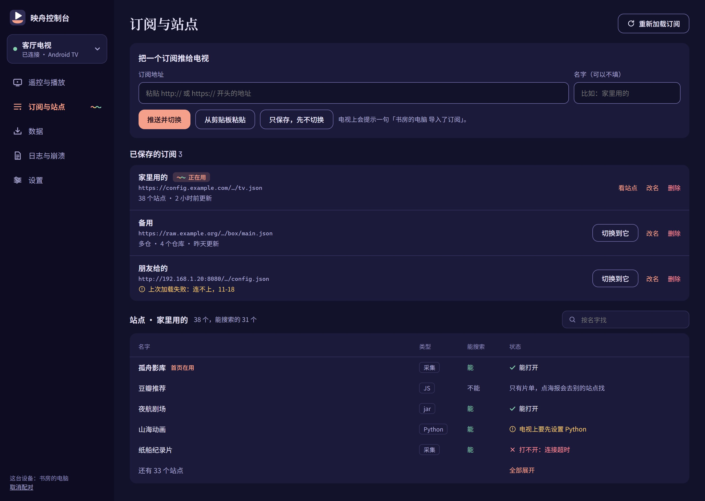 | 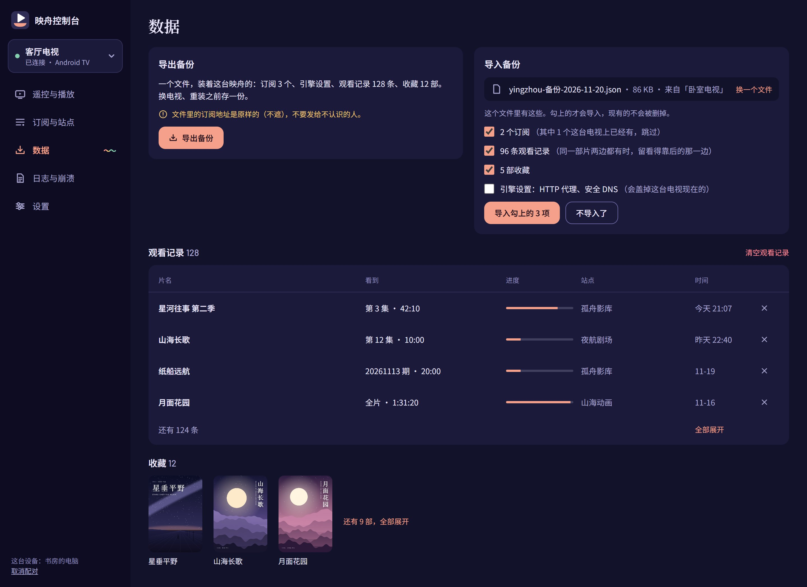 |

- **订阅与站点**：最上面是「把一个订阅推给电视」，粘贴地址就行，不用遥控器一个字一个字按；下面是已保存的订阅（切换、改名、删除）和当前订阅的站点（类型、能不能搜索、能不能打开）。
- **数据**：导出一个备份文件（订阅、设置、观看记录、收藏）；导入时先列出文件里有什么，勾上的才导入，现有的不会被删。下面管理观看记录和收藏。

| 日志与崩溃 | 设置 |
|---|---|
| 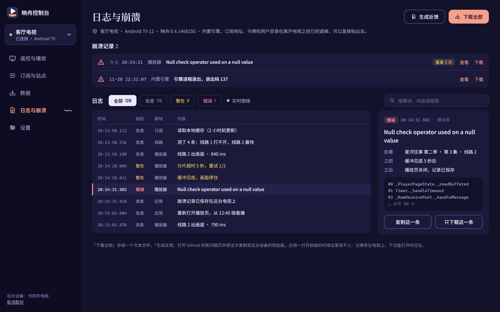 | 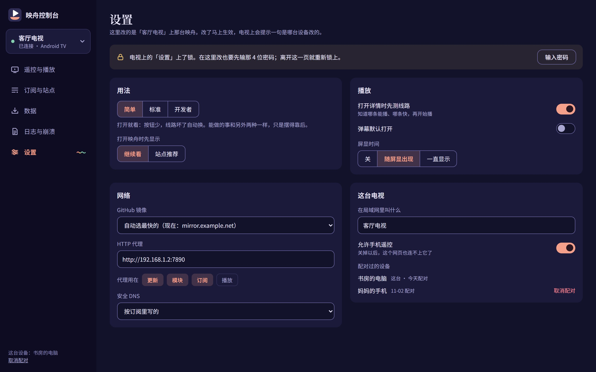 |

- **日志与崩溃**（这几页里最先做的）：崩溃记录、日志（按级别筛选、搜索、实时跟随）、选中一条看细节。「下载全部」存成文件，「生成反馈」打开 GitHub 的新问题页。内容离开电视之前已经遮掉订阅地址和令牌。
- **设置**：用法、打开时先显示什么、播放、网络、这台电视叫什么、配对过哪些设备。电视上的设置上了锁时，这里也要先输那 4 位密码。

| 手机上的「更多」 | 手机上的日志与崩溃 |
|---|---|
| 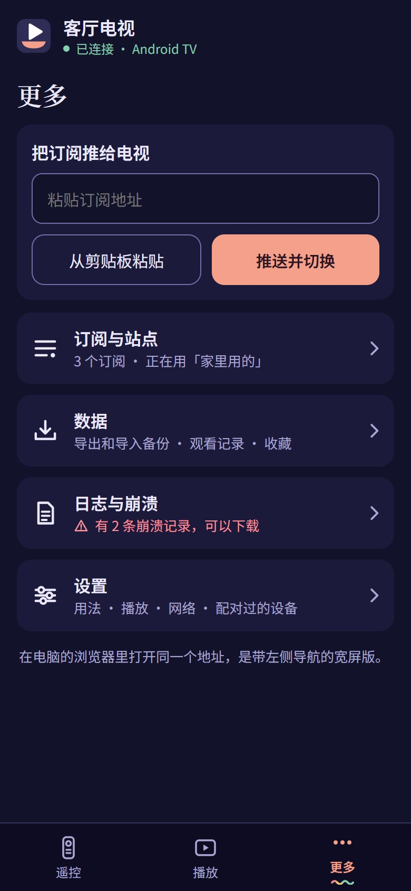 | 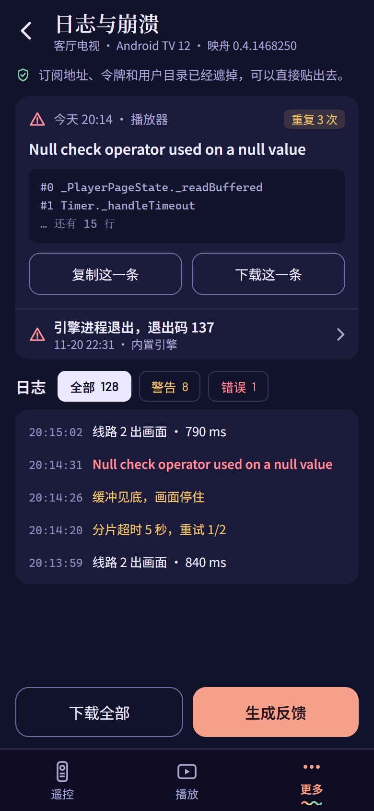 |

- 手机上底栏是遥控、播放、更多。「更多」最上面还是「把订阅推给电视」，下面是其余几页的入口；有崩溃记录时入口上直接写出来。
- 电视盒子崩溃后怎么把记录拿出来：手机扫电视上的二维码，打开这一页，「下载全部」或者「生成反馈」。

## 这些原型守的规则

- 最重要的一件事最大、最先看到，焦点一开始就在它上面。
- 出错时说人话、给下一步；错误码、网址和耗时只在开发者模式里出现。
- 珊瑚色只用在要按的地方；三色水纹只表示「流」：进度、缓冲、多条线路、当前所在。
- 电视上每个能按的东西都有清楚的焦点框，方向键走得到，返回键退得回。

- 要按的东西不挪位置：遥控器的方向键、拨盘里正在调的那一项、控制台的导航，内容怎么变它们都在原地。
- 等的时候看得见在等什么，并且有一个能自己动手的选择。

完整的设计规则（样子和「交互：七条规则」）见 [../system/README.md](../system/README.md)，界面怎么在真实应用里验证见 [../../design-lab.md](../../design-lab.md)。
