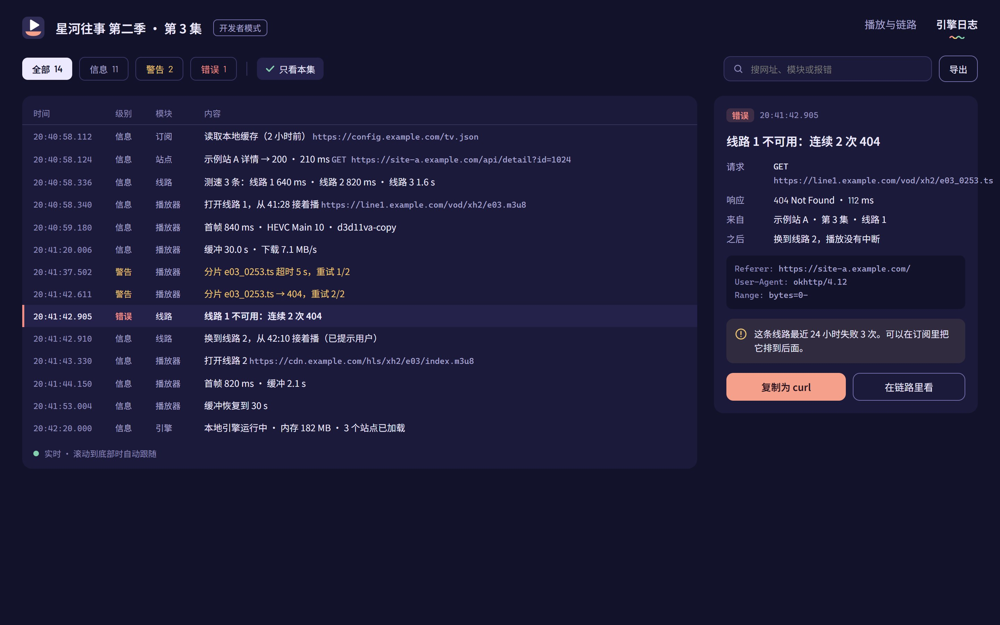

# 原型：三种用法

映舟三种用法（简单、标准、开发者）的界面原型，用「夜航」设计系统画成。原型定的是**要做什么、各放在哪、先看到什么**；应用里的实际样子以代码为准，两者对应关系见每张图下面。

- 图片可以直接看；`*.html` 用浏览器打开就是同一块画板，板与板之间的链接能点（比如「继续播放」进播放页）。
- `canvas/` 是这些画板的源文件，给 Claude 的 Design 画布用（`canvas.json` 记着每块画板的位置和标题）。改原型改这里，然后运行 `node tools/design/export-prototypes.mjs` 重新生成旁边的 `*.html` 和图片。
- 图里的片名、频道、站点名、海报都是虚构的演示内容。

## 第一次打开：选一种用法

| 电视 | 手机（浅色） |
|---|---|
|  |  |

三张卡片，每张写清楚这种用法做什么、给谁用。电视上焦点落在「简单」，按 OK 就用它开始；手机上先选再点下面的按钮。以后在「设置 → 外观 → 用法」里换。

应用里：`client/lib/pages/mode_chooser.dart`。只在全新安装第一次打开时出现。

## 简单模式：打开就看

- 首页最先看到的是上次没看完的那部片，焦点直接在「继续播放」上，按一下就从停下的地方接着放。
- 顶上的站点按钮打开右边的弹出栏换站点（和订阅、多仓里的仓库），不用进设置。
- 下面是最近看过和收藏；站点的推荐和分类在后面的标签里。

应用里：首页第一个标签「继续看」（`simple_home.dart`），站点按钮和弹出栏在 `home_switcher.dart`。原型里「常看的频道」一行，应用里是「最近看过」和「收藏」两行海报。

- 线路坏了自动换，只说一句人话："这条线路打不开，已换到下一条，从 42:10 接着播"，不出现错误码和网址。
- 控制条：暂停 / 继续、下一集、字幕、倍速、弹幕。不列线路；只有所有线路都试过还不行时，才让人自己挑。
- 进度条是三色水纹：珊瑚色是看过的，后面淡色的是已经缓冲的。

| 手机首页（浅色） | 设置上锁（浅色） |
|---|---|
|  |  |

- 手机上同样是一张「继续看」的大卡片，一个占满宽度的「继续播放」，站点按钮在标题旁边。
- 设置可以用 4 位密码锁住：防的是误改订阅和用法，看片、直播、搜索都不受影响。电视上可以直接按遥控器的数字键。

应用里：`ui/pin_pad.dart`。忘记密码的办法见使用说明。

## 开发者模式：看清每一步

- 画面左上角的播放统计（按 I 开关）：编码、分辨率、帧率、硬解还是软解、输出、掉帧、音频、音画同步、码率、缓冲和网速，数字来自 libmpv。
- 右边「片源从哪来」：订阅 → 站点 → 线路（被跳过的线路和原因也列着）→ 解析 → 播放地址和请求头 → 首帧，每一步多少毫秒。「复制诊断信息」会先去掉订阅地址和密钥。
- 下面是线路对比：哪条打不开、哪条正在用、哪条慢。

应用里：`pages/player_dev.dart`。播放统计和链路面板已有；线路对比表还没有做，线路的情况在链路面板和日志里。

- 每一步的记录，最新的在上面；按级别筛选、搜索；选中一条在右边看它的地址、回应和请求头，可以「复制为 curl」。

应用里：`diagnostics/dev_log_page.dart`，记的是这台设备上客户端看到的每一步（连接引擎、加载订阅、解析、出画面、线路失败、换线路、换站点）。引擎自己的日志接口和「复制为 curl」还没有做。

## 这些原型守的规则

- 最重要的一件事最大、最先看到，焦点一开始就在它上面。
- 出错时说人话、给下一步；错误码、网址和耗时只在开发者模式里出现。
- 珊瑚色只用在要按的地方；三色水纹只表示「流」：进度、缓冲、多条线路、当前所在。
- 电视上每个能按的东西都有清楚的焦点框，方向键走得到，返回键退得回。

完整的设计规则见 [../system/README.md](../system/README.md)，界面怎么在真实应用里验证见 [../../design-lab.md](../../design-lab.md)。
